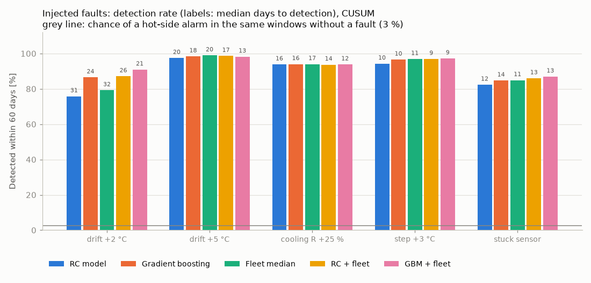
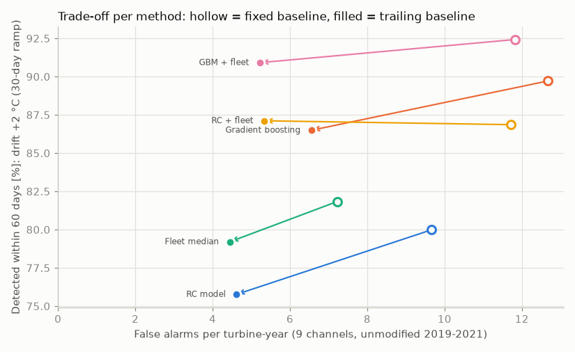
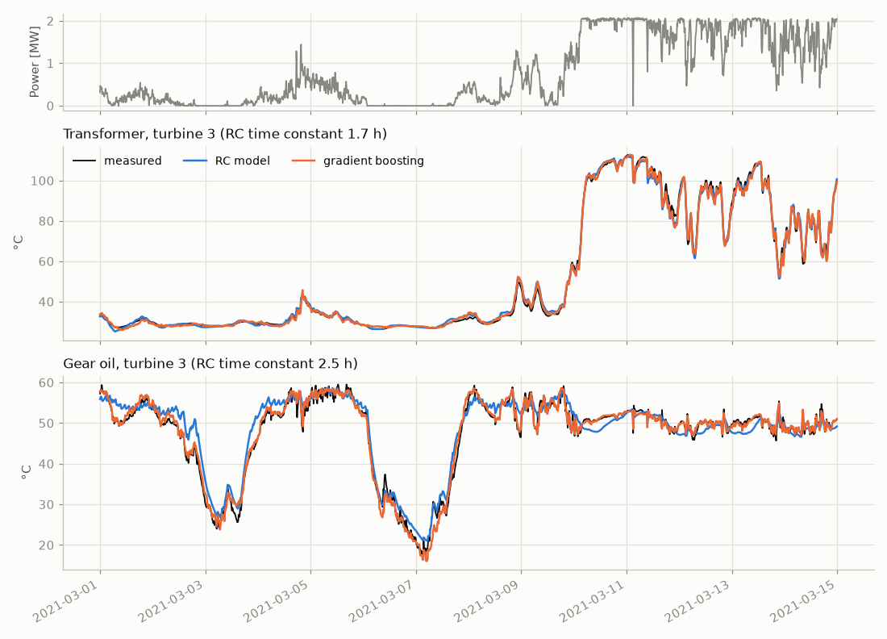
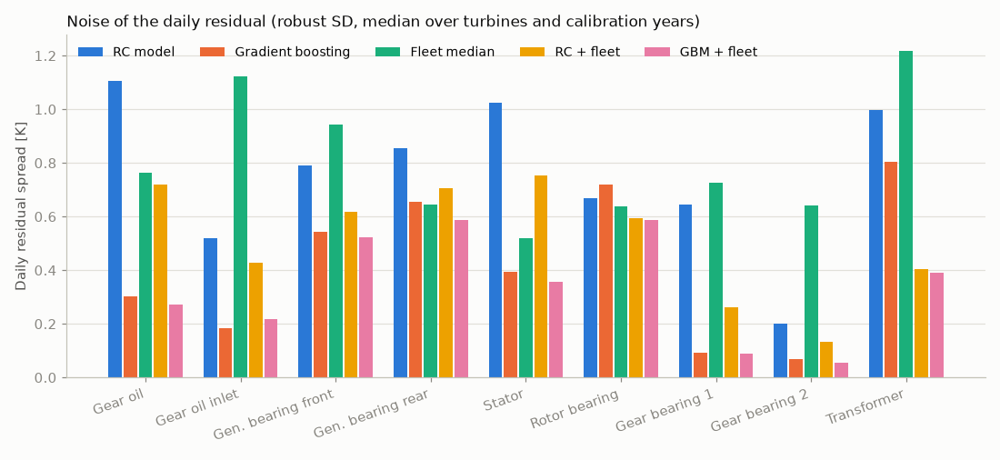
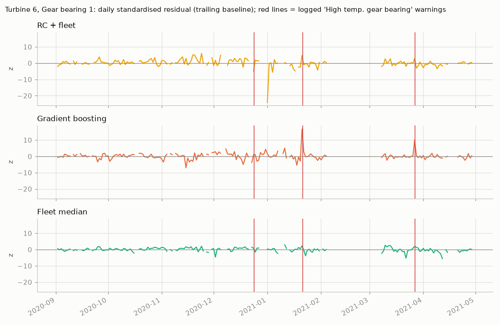
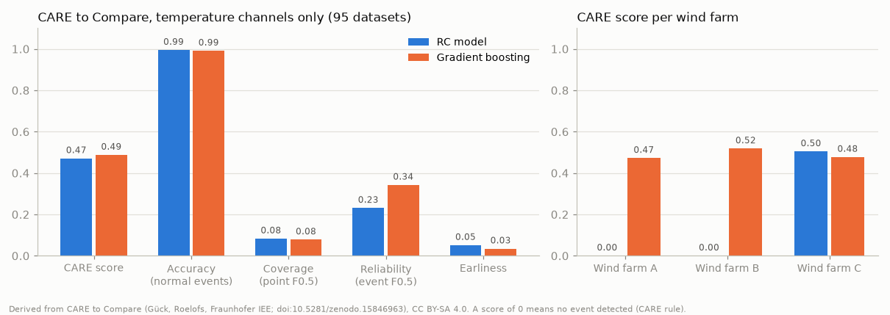
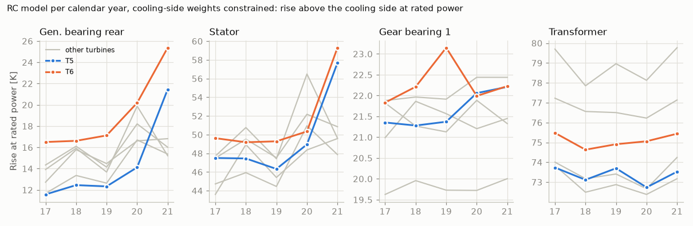
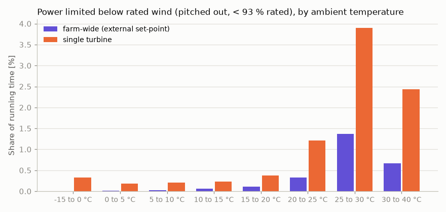

# Thermal normal behaviour models for wind turbine drivetrains

[](https://github.com/kwwaleszczynski-del/wind-thermal-nbm/actions/workflows/ci.yml)

Early warning of drivetrain faults from the temperatures every turbine already logs. A **normal behaviour model
(NBM)** predicts what a component temperature should be under the current load and weather; a residual that
drifts away from zero is the warning. This repository compares three ways to build that expectation on six
years of open 10-minute SCADA data from the **Kelmarsh wind farm** (UK, 6 x Senvion MM92, 2 MW):

- **(a) a physical first-order thermal (RC) model** per turbine and component, the method developed here: seven
  parameters (time constant, temperature rise at rated power, coupling to the air or oil that cools the
  component), which keep a physical meaning when the cooling-side weights are constrained to a mixture;
- **(b) gradient-boosted trees** on current and lagged operating conditions, the usual industrial NBM;
- **(c) the fleet reference**: the component temperature against the median of the other producing turbines at
  the same moment, which removes the weather without modelling it;

plus the two combinations of a model with the fleet reference. Nine channels are monitored per turbine: gear
oil and gear oil inlet, the two gearbox bearings, the two generator bearings, the stator winding, the rotor
(main) bearing and the transformer.

Everything is validated without peeking: models are trained on year Y-2, alarm thresholds are set on Y-1 and all
numbers are measured on Y = 2019, 2020 and 2021. Known faults (drifts, a cooling degradation, a step, a stuck
sensor) are injected into the real test-year data, logged warnings from the turbines' status files are checked
for early signs, and the physical and the ML model are also run on the public **CARE to Compare** fault-detection
benchmark (95 datasets from three other wind farms). The Kelmarsh data answer a second question as well: **do the
turbines limit their power when they run hot, and what does that cost?**

**Interactive dashboard:** thermal health map turbine x component x month, daily residuals and alarms per
turbine - [kwwaleszczynski-del.github.io/wind-thermal-nbm](https://kwwaleszczynski-del.github.io/wind-thermal-nbm/).

## Key results

8 100 injections per method (5 faults x 9 components x 6 turbines x 10 onsets x 3 test years; the 2 % of windows
with less than 30 days of data are not scored), CUSUM chart on the daily residual with a trailing baseline (see
[Alarms](#alarms)); detection = a hot-side alarm within 60 days of the fault onset. False alarms are counted on the unmodified test years.

| Method | Daily residual noise | Drift +2 °C | Drift +5 °C | Cooling R +25 % | Step +3 °C | Stuck sensor | False alarms per turbine-year (hot side) |
|---|---|---|---|---|---|---|---|
| (a) RC model | 0.78 K | 76 % (31 d) | 97 % (20 d) | 94 % (16 d) | 94 % (10 d) | 82 % (12 d) | 4.6 (3.4) |
| (b) Gradient boosting | 0.39 K | 86 % (24 d) | 98 % (18 d) | 94 % (16 d) | 97 % (10 d) | 85 % (14 d) | 6.6 (3.5) |
| (c) Fleet median | 0.76 K | 79 % (32 d) | 99 % (20 d) | 94 % (17 d) | 97 % (11 d) | 85 % (11 d) | **4.4 (2.2)** |
| RC + fleet | 0.55 K | 87 % (26 d) | 99 % (17 d) | 94 % (14 d) | 97 % (9 d) | 86 % (13 d) | 5.3 (3.6) |
| GBM + fleet | **0.35 K** | **91 % (21 d)** | 98 % (13 d) | 94 % (12 d) | 97 % (9 d) | 87 % (13 d) | 5.2 (3.1) |

Days in brackets: median time to detection. Chance of a hot-side alarm in the same 60-day windows without a
fault: 2-3 %. Residual noise: robust standard deviation of the daily mean residual in the calibration years,
median over channels. False alarms: all directions over the nine channels of a turbine, hot side in brackets.

- **There is no single winner, and the gaps are smaller than the residual noise suggests.** Gradient boosting
  halves the day-to-day noise of the RC model (0.39 vs 0.78 K), but its alarm thresholds have to be just as wide:
  what limits every method is not the daily noise but slow, weather-driven wander of the residual that lasts for
  weeks. Large faults (+5 °C, +3 °C steps, a 25 % cooling loss) are caught by all methods in 94-99 % of cases;
  the +2 °C drift separates them (76-91 %).
- **The physical model is competitive where the physics is simple** and loses where controllers dominate. With
  the gear oil as the cooling side, the RC model of the two gearbox bearings has 0.2-0.65 K of noise, catches every
  +2 °C drift and raises few false alarms on them (4 and 1 in three years on bearings 1 and 2, against 16 and 7
  for gradient boosting). On the transformer it catches 92 % of +2 °C drifts (GBM 95 %). On the fan- and thermostat-controlled
  channels (generator bearings, stator, gear oil) a single linear RC element cannot follow the control and
  catches 41-74 % (GBM 54-100 %).
- **Referencing a model to the fleet is the most useful single step.** Subtracting the median residual of the
  other producing turbines cancels the model error the six identical turbines share: RC noise drops from 0.78
  to 0.55 K and its +2 °C detection rises from 76 to 87 %.
- **False alarms come from year-to-year shifts, not from the charts.** With a fixed baseline (the calibration
  year's median) every method raises 7-13 alarms per turbine-year on unmodified data, about as many cold as hot,
  most of them on the slow rotor bearing and the generator channels. A trailing baseline (median of days t-120
  to t-31) halves that at a cost of 0-4 points of detection (see the trade-off figure). The fleet reference is the
  most stable (4.4 per turbine-year).
- **With the cooling-side weights constrained, the RC parameters give a health trend that the black box does
  not.** Refitted per calendar year with the weights held non-negative and summing to 1 (left free they drift:
  on T5's rear generator bearing the nacelle-air weight went from 1.41 to 2.11 and the outside-air weight from
  -0.44 to -1.06, and the rise moved with them), the temperature rise of the rear generator bearing at rated
  power grows from 16.5 to 25.4 K on T6 (2017-2021) and from 11.6 to 21.5 K on T5, while the other four end at
  15.2-16.8 K; T5 and T6 also lead the fleet in stator temperature rise in 2021.
- **The logged warnings at Kelmarsh are not predictable from the temperatures - and do not need to be.** Of 42
  logged warning episodes on the monitored components (2019-2021), each method had an alarm in the 60 days
  before 2-4, about what chance gives (3.6-5.0). The four "High temp. gear bearing 1" warnings on T6 are acute:
  on three of the four warning days the gradient-boosting residual jumps to 10-17 standard deviations, with
  nothing in the month before. The status logs contain no slowly developing drivetrain failure in the test years, which is
  why the injected faults carry the comparison.
- **On the CARE to Compare benchmark the temperature models are precise but not general fault detectors.** On
  95 labelled datasets from three other wind farms, using only the temperature channels, gradient boosting
  reaches a CARE score of 0.49 and the RC model 0.47 (the benchmark paper reports 0.66 for its autoencoder on all
  features and 0.5 for random predictions). Both are right on 99 % of the normal points but catch only 5 and 3 of
  the 45 faults: 28 of those are in systems no temperature sensor watches (pitch, hydraulics, brakes, yaw,
  communication, converter), and even the gearbox, bearing and transformer faults rarely show as a lasting
  temperature rise before the failure.
- **Thermal derating costs Kelmarsh almost nothing.** Below rated wind, the share of running time in which a
  single turbine pitches power away rises from 0.2-0.4 % at ambient temperatures below 20 °C to 2.4-3.9 % above
  25 °C, but hot weather comes with weak wind: in five years there was not one hour above 25 °C with wind at
  rated speed. Power limited while a component or the air was hot cost 0.3-2.8 MWh per year (at most 0.01 % of
  production, the most in the hot summer of 2018).





*Each arrow goes from the fixed to the trailing baseline: false alarms halve, detection of the +2 °C drift
drops by 1-4 points.*

## Data

[Kelmarsh wind farm data](https://doi.org/10.5281/zenodo.16807551) (C. Plumley and R. Takeuchi, Cubico
Sustainable Investments, CC BY 4.0): yearly archives with one 10-minute Greenbyte export (~460 signals) and one
status log per turbine. This project reads 9 component temperatures, the nacelle and outside air temperature,
power, rotor speed, both nacelle anemometers and the pitch angle for 2016-2021 (1.9 million rows), plus the
status logs. Temperatures in the export include sensor error values such as -273.2 °C; values outside
-40...150 °C are dropped. Temperatures only start in May 2016, so the first training year is 2017.

| Channel | Greenbyte title | Notes |
|---|---|---|
| Gear oil | Gear oil temperature | sump, thermostat-regulated to about 50-60 °C |
| Gear oil inlet | Gear oil inlet temperature | after the oil cooler |
| Gear bearing 1 / 2 | Front / Rear bearing temperature | gearbox ("axle") bearings, about 70 °C in operation; the controller's "High temp. gear bearing 1" warnings coincide with peaks of channel 1 |
| Gen. bearing front / rear | Generator bearing front / rear temperature | fan-cooled generator |
| Stator | Stator temperature 1 | fan- and heater-controlled |
| Rotor bearing | Rotor bearing temp | main bearing, slow |
| Transformer | Transformer temperature | up to 117 °C at full load |

## Method

### (a) First-order thermal model (own method)

Each component is one thermal capacity $`C`$ behind one thermal resistance $`R`$ to whatever cools it:

```math
C\,\frac{dT}{dt} = Q_\mathrm{loss} - \frac{T - T_\mathrm{ref}}{R}
\quad\Longrightarrow\quad
\tau\,\frac{dT}{dt} = T_\mathrm{ss} - T, \qquad \tau = R\,C
```

The steady-state temperature is linear in the loss terms (copper losses scale with $`P^2`$, gear mesh and
bearing losses with $`P`$ and the rotor speed $`\omega`$) and in the cooling-side temperatures:

```math
T_\mathrm{ss} = \theta_0 + \sum_k \theta_k\,T_{\mathrm{ref},k} + \theta_P\,P + \theta_{P2}\,P^2 + \theta_\omega\,\frac{\omega}{\omega_\mathrm{rated}}
```

The cooling side is the nacelle and outside air for most components and the **gear oil** for the gearbox
bearings and the cooler outlet, which sit in it. That one physical choice cuts the gearbox-bearing residual
noise two- to fourfold (1.30 → 0.65 K on bearing 1, 1.05 → 0.24 K on bearing 2, trained on 2017 and scored on
2018). Over a 10-minute step the model is an exponential
filter of the steady state,

```math
\hat T_t = a\,\hat T_{t-1} + (1-a)\,T_{\mathrm{ss},t}, \qquad a = e^{-\Delta t/\tau}
```

run as a **simulation from the inputs only**: the model never sees the measured temperature, so a fault in the
measurement stays in the residual instead of being followed (a one-step-ahead predictor would track a slow
drift). For a given $`\tau`$ the simulated temperature is linear in $`\theta`$, so the fit is a one-dimensional
search over $`\tau`$ with least squares inside (variable projection). Gaps of up to 30 minutes are interpolated;
after a longer gap the filter restarts in steady state and the first 6 hours are not scored.

Fitted parameters (median over turbines and training years 2017-2019):

| Component | Cooling side | $`\tau`$ | Rise at rated power | Fit RMSE |
|---|---|---|---|---|
| Transformer | outside air ($`\theta_\mathrm{amb}`$ = 1.09) | 1.6 h | 74 K | 1.4 K |
| Rotor bearing | nacelle + outside air | 6.1 h | 11 K | 0.8 K |
| Gear bearing 1 | gear oil ($`\theta_\mathrm{oil}`$ = 0.94) | 0.17 h | 22 K | 1.6 K |
| Gear bearing 2 | gear oil (0.91) | 0.11 h | 19 K | 1.0 K |
| Gear oil inlet | gear oil (1.03) | < 0.1 h | -9 K (cooler drop) | 3.4 K |
| Gear oil | nacelle + outside air | 2.6 h | 24 K | 2.2 K |
| Stator | nacelle + outside air | 0.9 h | 48 K | 2.7 K |
| Gen. bearing rear | nacelle + outside air | 1.1 h | 14 K | 1.9 K |
| Gen. bearing front | nacelle + outside air | 0.4 h | 2 K | 2.1 K |

The time constants read like a data sheet: the transformer follows the outside air (it is not in the nacelle air
stream), the main bearing is the slowest mass, the gearbox bearings follow the oil within minutes. These are the
detection fits, whose cooling-side weights are left free because that predicts best; a weight above 1 or below 0
(1.09 on the transformer; medians of 1.35-2.03 on the nacelle air with a negative outside-air weight for the gear
oil, stator and generator bearings, `results/rc_params.csv`) means the nacelle temperature, which the drivetrain heats, also carries part of the load term, so the
rise of a free fit is not a clean physical quantity. The yearly trend below constrains the weights. Where
controllers act the RC element is a compromise: the gear oil is held at 50-60 °C by a thermostatic bypass and a
cooler fan (it is *cooler* at full load than at part load), and the stator and generator bearings cycle with
their fans. A clamped steady state for heater/thermostat floors and a second time constant were tried; neither
reduced the daily residual noise by more than 0.1 K, so the model stayed at one element.



*Transformer (passive, both models follow it) and gear oil (regulated; the RC element misses part of the
thermostat behaviour) on turbine 3 in March 2021, both models trained on 2019.*

### (b) Gradient boosting

`HistGradientBoostingRegressor` (300 trees, 31 leaves) per turbine and component on the same information as
the RC model - power, rotor speed and the same cooling-side temperatures - each with trailing means over 1, 3,
6 and 12 hours so the trees can learn the thermal lag. The target's own past values are deliberately not used,
for the same reason the RC model is simulated.

### (c) Fleet reference and the combinations

```math
r_i = \bigl(T_i - \mathrm{med}_{j \ne i} T_j\bigr) - \bigl(c_0 + c_1\,\Delta P + c_2\,\Delta P^2\bigr),
\qquad \Delta P = \bar P_{i,1h} - \mathrm{med}_{j \ne i} \bar P_{j,1h}
```

The median runs over the other turbines that are producing at that moment (at least three; an idle turbine
cools down and is no reference). The quadratic in the power difference, fitted per turbine on the training year,
removes the effect of a different load (a waked turbine runs cooler) and the constant offset of each sensor.
The combinations apply the same idea to the model residuals: $`r_i - \mathrm{med}_{j \ne i} r_j`$ cancels
the model error that the six identical turbines share at the same moment.

### Alarms

Residuals are averaged per day over the hours in production (at least 6 h with power above 100 kW), divided by
the robust spread of the calibration year and clipped to ±5. Two baselines are compared: **fixed** (the
calibration year's median) and **trailing** (the median of days t-120 to t-31, causal). Two charts run on the
daily z: a two-sided **CUSUM** with reference value k = 1 (tuned to shifts of two daily standard deviations;
k = 0.5 mostly accumulated the weeks-long wander of the residual) and an **EWMA** with λ = 0.2. Thresholds
are set per method, component and chart on the calibration year: the smallest value at which none of the six
turbines alarms. Both charts reset after an alarm. All results above are CUSUM; the EWMA detects 6-14 points
less of the +2 °C drifts but alarms earlier, with similar false alarm rates
([results/injection_summary.csv](results/injection_summary.csv)).

## Validation 1: injected faults

Faults are added to the measured temperature of one channel; none of the models uses the measured target as an
input, so the residual of every method moves by exactly the injected amount and nothing has to be refitted.
The faults are defined from measured data only, not from any of the models:

| Fault | Definition |
|---|---|
| Drift +2 / +5 °C | linear ramp to +2 / +5 °C over 30 days, then held (sensor or component drift) |
| Cooling R +25 % | the temperature rise above the nacelle air grows by 25 % over 30 days: fouled cooler or weak fan; load-dependent |
| Step +3 °C | sudden offset |
| Stuck sensor | the reading freezes at its value at onset |

Onsets are the first day of each month January-October of each test year; the chart is restarted at onset and
must alarm in the fault's direction (either direction for the stuck sensor) within 60 days.

Detection of the +2 °C drift by component (trailing baseline, CUSUM):

| Component | RC | GBM | Fleet | RC + fleet | GBM + fleet |
|---|---|---|---|---|---|
| Gear bearing 1 | 100 % | 100 % | 95 % | 100 % | 100 % |
| Gear bearing 2 | 100 % | 100 % | 100 % | 100 % | 100 % |
| Gear oil inlet | 98 % | 100 % | 74 % | 98 % | 100 % |
| Transformer | 92 % | 95 % | 52 % | 100 % | 100 % |
| Gear oil | 74 % | 100 % | 98 % | 90 % | 100 % |
| Stator | 67 % | 100 % | 89 % | 85 % | 100 % |
| Rotor bearing | 69 % | 68 % | 62 % | 69 % | 68 % |
| Gen. bearing front | 42 % | 54 % | 74 % | 74 % | 82 % |
| Gen. bearing rear | 41 % | 62 % | 69 % | 68 % | 68 % |

The cooling fault is caught in 94-100 % on every component except the rotor bearing (46-54 % for all methods):
its temperature rise above the nacelle air is only a few kelvin, so 25 % of it is small.



## Validation 2: logged warnings

The status logs of 2019-2021 contain 53 warning episodes (events on the same turbine within 14 days merged) on
the monitored components: 46 generator cooling episodes (fan and heater overloads), 4 "High temp. gear bearing
1" on T6, 2 transformer fan overloads and one choked gear oil filter on T1. 11 of the generator episodes hit
three or more turbines within three days and look like service visits, so 42 are scored. An episode counts as
anticipated if the method raised a hot-side alarm on one of the component's channels in the 60 days before it;
the chance level is the fraction of all days that have such an alarm in the 60 days before them.

| Method | Anticipated (of 42) | Expected by chance |
|---|---|---|
| RC | 2 | 3.6 |
| Gradient boosting | 3 | 4.5 |
| Fleet median | 3 | 4.4 |
| RC + fleet | 4 | 5.0 |
| GBM + fleet | 4 | 4.8 |

None of the methods does better than chance, and all the hits are generator cooling warnings. The episodes are
short warnings, not developing failures: the gear bearing 1 channel of T6 shows no rise in the weeks before its
four "High temp. gear bearing 1" warnings, but on three of the warning days the residual jumps to z = 10-17
(gradient boosting; RC: 3-5 on two of them). The transformer fan overload on T2 (31 July - 22 September 2020) left
the transformer temperature where the models expected it (mean z 0.1-0.7 before and during). An honest reading:
Kelmarsh had no slowly developing drivetrain failure in the three test years, and the NBMs did not invent one.



## Validation 3: the CARE to Compare benchmark

[CARE to Compare](https://doi.org/10.5281/zenodo.15846963) (Gück, Roelofs, Faulstich 2024) is a public
benchmark for early fault detection: 95 datasets from three wind farms (A: 5 onshore turbines in Portugal from
the EDP open data; B and C: offshore wind farms in Germany, anonymised), each one turbine with about a year of
10-minute training data and a prediction section that holds either a labelled anomaly leading up to a fault
(45 datasets) or normal behaviour (50). Its **CARE score** combines Coverage (point-wise F0.5 on the anomaly
windows), Accuracy (on normal datasets, double weight), Reliability (event-wise F0.5; an event counts as
detected when a criticality counter reaches 72, i.e. 12 hours of net anomalous points) and Earliness. It is
computed here with an own implementation of the published definition, which reproduces the authors' reference
code to four decimals on all 95 datasets.

How the models were applied, all fixed before looking at any prediction section:

- every component temperature of the farm is a channel (22 on A, 23 on B, 71 on C), with power, rotor speed and
  the outside (and, on A, nacelle) temperature as inputs; gearbox bearings get the gear oil as cooling side;
- per dataset, RC and gradient-boosting models are fitted on the first 75 % of the training section (normal
  status only) and calibrated on the last 25 %;
- the residual is smoothed with a 6-hour median (the data contain short sensor drop-outs to -50 °C), divided by
  its calibration spread (at least 0.25 K), and the largest hot-side z over all channels is the anomaly score; a
  point is anomalous above the 99.5 % quantile of the score on the calibration slice;
- wind farm A's status labels come from the failure log and, as the dataset authors advise, are used only to
  filter the training data; the fleet reference does not apply (one turbine per dataset).

| Method | CARE score | Accuracy | Coverage | Reliability | Earliness | Faults detected | Normal datasets flagged |
|---|---|---|---|---|---|---|---|
| RC model | 0.47 | 0.994 | 0.08 | 0.23 | 0.05 | 3 of 45 | 2 of 50 |
| Gradient boosting | 0.49 | 0.991 | 0.08 | 0.34 | 0.03 | 5 of 45 | 2 of 50 |

With the threshold at the 99 % quantile both reach 0.52 (8 faults each), at 99.9 % 0.47 and 0.47. For
orientation, the benchmark paper reports 0.66 for its autoencoder on all features and 0.5 for random predictions
on an earlier version of the dataset. Per farm the RC model detects nothing on A and B, which the CARE rule
scores as 0, and reaches 0.50 on C; gradient boosting scores 0.47, 0.52 and 0.48.

The logged root causes explain most of it. 28 of the 45 faults are in systems that no temperature sensor
watches (pitch drives and batteries, hydraulics, brakes, yaw, blades, communication, converter), and the
temperature models detect 3 of them each. Of the 17 gearbox, bearing, generator, cooling and transformer faults
gradient boosting detects 2 and the RC model none: a main bearing damage on wind farm B, flagged 35 days before
the failure through the generator bearing temperature, and one "high temperature in transformer cell" event,
flagged through the generator slip ring temperature rather than the transformer channels (the same channel also
flags one normal dataset). The two other transformer-cell events, and the transformer, gearbox and generator
bearing failures of wind farm A, are not detected. The clearest hit is a hydraulic fault on wind farm C
(event 47): the RC model flags it 4 days before the failure through the hydraulic oil tank temperature, the same
channel in which the dataset authors note "a longer anomaly". Overall the
temperature models are what they were built to be: a precise thermal layer (99 % of normal points left alone,
2 of 50 normal datasets flagged) rather than a general fault detector, and they need the other SCADA signals
next to them to compete on this benchmark.



*Derived from CARE to Compare (C. Gück, C. Roelofs, Fraunhofer IEE, doi:10.5281/zenodo.15846963), CC BY-SA 4.0.
The figure and the tables in [results/care/](results/care/) are licensed CC BY-SA 4.0; see
[results/care/LICENSE](results/care/LICENSE).*

## Physical health trend

Refitting the model on each calendar year turns its parameters into a trend per turbine, but only if the
cooling-side weights cannot drift. Left free, they trade off against the load terms: on T5's rear generator
bearing the nacelle-air weight rose from 1.41 to 2.11 and the outside-air weight fell from -0.44 to -1.06
between 2017 and 2021, so a change of the rise could come from the weights as well as from the cooling. The trend
fits therefore hold the weights non-negative and summing to 1 (the component sits at a mixture of the
temperatures that cool it, plus the rise). The generator channels and the stator then sit on the nacelle air
(weight 1) in every year, the transformer on the outside air, the gearbox bearings on the oil, so the rise is
compared on the same footing from year to year. The price is a looser fit (median RMSE 2.25 instead of 1.91 K on
the rear generator bearing, 4.10 instead of 2.70 K on the stator, 2017-2019), which is why the detection models
keep their free weights.

With that, the temperature rise at rated power of the rear generator bearing grows from 16.5 to 25.4 K on T6 and
from 11.6 to 21.5 K on T5 between 2017 and 2021, while the other four end at 15.2-16.8 K; T5 and T6 also lead the
stator rise in 2021 (57.7 and 59.3 K vs 47.9-50.8 K). A higher rise at the same load means more heat per watt or
less cooling - the signature of the cooling degradation injected above. T5 and T6 logged generator fan and heater
overloads in most years, as did the other turbines. The whole fleet's generator rise jumps in 2020, which a
fleet-relative reading separates from the turbine-specific trend. The transformer and the gearbox bearings move
by at most 2 K per turbine over the five years (`results/rc_by_year.csv`).



## Thermal power limitation

Below rated wind a freely running turbine keeps its blades at fine pitch. Pitch above 3° with power below 93 %
of rated at a density-normalised wind speed of 4-10 m/s means the turbine is limiting itself or being limited.
When three or more turbines are limited at the same moment the cause is external (curtailment, park control);
a single limited turbine is attributed to heat when one of its component temperatures is in that component's
hottest 1 % or the air is above 25 °C. Lost energy is the turbine's own power curve (median power per 0.5 m/s
bin at fine pitch, IEC-style density normalisation) minus the measured power.

| Year | Farm-wide limitation | Single turbine, hot | Single turbine, other | Production |
|---|---|---|---|---|
| 2017 | 13 h, 3.1 MWh | 4 h, 0.3 MWh | 55 h, 8.0 MWh | 32.4 GWh |
| 2018 | 40 h, 3.7 MWh | 44 h, 2.8 MWh | 100 h, 11.5 MWh | 30.1 GWh |
| 2019 | 30 h, 3.7 MWh | 10 h, 0.7 MWh | 102 h, 12.0 MWh | 30.9 GWh |
| 2020 | 24 h, 1.9 MWh | 10 h, 0.7 MWh | 102 h, 11.8 MWh | 36.4 GWh |
| 2021 | 21 h, 2.2 MWh | 8 h, 0.5 MWh | 99 h, 11.9 MWh | 27.9 GWh |

Heat does change behaviour: single-turbine limitation is about ten times more frequent above 25 °C than below
20 °C, and above 25 °C about a quarter of it happens with a component in its hottest 1 %. But the energy is negligible because
hot British days are calm: the turbines never ran in rated wind with the air above 25 °C (highest power in such
conditions 1.94 MW), so the summer capability at full load is simply untested by this site. The status logs
record a single "Reduced power" warning in 2017-2021 (converter, 31 minutes, 0.14 MWh).



## Limitations

- **Six turbines, one site, three test years, no slow real failure.** The comparison rests on injected faults;
  they are realistic in size and shape but cleaner than real degradation, and a fault that grows over many
  months would be partly absorbed by the trailing baseline.
- **Thresholds are tuned for zero alarms in one calibration year.** That rule is simple and equal for all
  methods, but a single calibration year is a small sample, and the resulting 4-7 alarms per turbine-year would
  still need triage in practice (about one alarm per turbine every two months over nine channels).
- **The fleet reference assumes a healthy majority.** A farm-wide problem (a bad firmware release, a common
  design fault) cancels out of every fleet-referenced residual, including the combinations.
- **The RC element is linear.** Fans, heaters and thermostatic valves make the stator, generator bearings and
  gear oil piecewise systems; a physical model of the controllers would need their set points, which the export
  does not contain.
- The injected cooling fault scales the temperature rise above the nacelle air but keeps the measured dynamics,
  i.e. it does not lengthen the time constant as a real increase of R would.

## Run it

```bash
python -m venv .venv
.venv/Scripts/pip install -e ".[dev]"     # Linux/macOS: .venv/bin/pip
python -m wind_thermal_nbm fetch            # ~1.8 GB from Zenodo into data/raw (or set KELMARSH_DATA_DIR)
python -m wind_thermal_nbm all --jobs 3     # prepare, fit, evaluate, derating, report (~15-20 min)
python -m wind_thermal_nbm fetch-care       # optional: CARE to Compare, 5.5 GB into data/care/raw (MD5-checked)
python -m wind_thermal_nbm care --jobs 4    # RC and GBM on all 95 CARE datasets (~55 min), results/care/
pytest -q                                   # 47 offline tests on synthetic data, ~20 s
```

Stages can be run on their own (`prepare`, `fit`, `evaluate`, `derating`, `report`); each reuses the caches in
`data/` unless `--refresh` is given. If the archives are already on disk elsewhere, point
`KELMARSH_DATA_DIR` at the folder that contains `raw/`.

| Path | Content |
|---|---|
| `src/wind_thermal_nbm/thermal.py` | RC model: simulation, variable-projection fit (free or mixture-constrained cooling weights), parameters |
| `src/wind_thermal_nbm/ml.py` | gradient-boosting NBM with lag features |
| `src/wind_thermal_nbm/fleet.py` | fleet-median reference with load correction |
| `src/wind_thermal_nbm/pipeline.py` | rolling train / calibrate / test protocol, residual cache, yearly RC fits |
| `src/wind_thermal_nbm/alarms.py` | daily residuals, CUSUM, EWMA, zero-alarm thresholds |
| `src/wind_thermal_nbm/faults.py` | injected faults |
| `src/wind_thermal_nbm/validation.py` | baselines, false alarms, injection study, logged-event scoring |
| `src/wind_thermal_nbm/derating.py` | power limitation and its energy cost |
| `src/wind_thermal_nbm/report.py`, `dashboard.html` | figures and the dashboard |
| `src/wind_thermal_nbm/care.py`, `care_score.py` | the models on CARE to Compare, own implementation of the CARE score |
| `results/` | all tables behind the numbers above (Kelmarsh, CC BY 4.0 data) |
| `results/care/` | CARE to Compare results, CC BY-SA 4.0 (see its LICENSE) |

## Data and license

Code: MIT.

Data: Kelmarsh wind farm data, C. Plumley and R. Takeuchi, Cubico Sustainable Investments,
[doi:10.5281/zenodo.16807551](https://doi.org/10.5281/zenodo.16807551), licensed
[CC BY 4.0](https://creativecommons.org/licenses/by/4.0/).

Benchmark: CARE to Compare, "Wind Turbine SCADA Data For Early Fault Detection", C. Gück and C. Roelofs
(Fraunhofer IEE), version of 9 July 2025, [doi:10.5281/zenodo.15846963](https://doi.org/10.5281/zenodo.15846963),
described in C. Gück, C. M. A. Roelofs, S. Faulstich, *CARE to Compare: A Real-World Benchmark Dataset for Early
Fault Detection in Wind Turbine Data*, Data 9(12), 138 (2024),
[doi:10.3390/data9120138](https://doi.org/10.3390/data9120138); licensed
[CC BY-SA 4.0](https://creativecommons.org/licenses/by-sa/4.0/). Everything derived from it (tables and the
figure in `results/care/`) is shared under CC BY-SA 4.0 as well, see [results/care/LICENSE](results/care/LICENSE).
The CARE score is computed by an own implementation of the published definition, cross-checked against the
authors' reference code ([EnergyFaultDetector](https://github.com/AEFDI/EnergyFaultDetector), MIT).

The repository contains derived results only; raw data of either source are downloaded by `fetch` /
`fetch-care` and are not redistributed.
